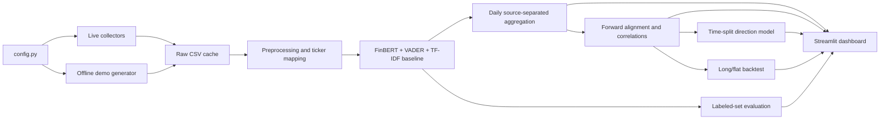

# AI-Based Financial Market Sentiment Analysis Using News and Social Media Data

A research/college project that collects ticker-related news from GDELT and public posts from Bluesky, downloads prices with yfinance, scores text with FinBERT plus VADER and TF-IDF baselines, aggregates daily sentiment, and compares it with later stock returns. It includes a deterministic offline demo, chronological market-model evaluation, a simple cost-aware backtest, and a Streamlit dashboard.

> Market sentiment is noisy and observational. The analysis is educational and is not financial advice. Demo records and prices are synthetic and must never be presented as live observations.

## Architecture



## Project layout

```text
config.py                    # Defaults, paths, aliases, model and backtest settings
run_pipeline.py              # One command for collect/demo through reports
src/collect.py               # Unified collector CLI/facade for all live sources
src/collect_news.py          # GDELT DOC news headline search
src/collect_bluesky.py       # Public Bluesky post search (no credentials)
src/collect_prices.py        # yfinance OHLCV and deterministic demo prices
src/load_datasets.py         # Financial PhraseBank/local CSV and offline fixtures
src/preprocess.py            # HTML/URL/mention cleaning, deduplication, ticker mapping
src/sentiment.py             # FinBERT, VADER, and TF-IDF/logistic regression
src/aggregate.py             # Daily news/social sentiment statistics
src/analysis.py              # Trading-day alignment, correlations, time split model
src/backtest.py              # Sentiment long/flat versus buy-and-hold
src/evaluate.py              # Holdout metrics and confusion matrices
app.py                       # Five-tab Streamlit dashboard
data/raw/                    # Cached source CSVs
data/processed/              # Clean, scored, daily, model and backtest outputs
reports/                     # Sentiment evaluation table/plot
tests/                       # Unit tests
```

## Setup

Use Python 3.10–3.12. From PowerShell in the project folder:

```powershell
python -m venv .venv
.\.venv\Scripts\python.exe -m pip install --upgrade pip
.\.venv\Scripts\python.exe -m pip install -r requirements.txt
Copy-Item .env.example .env
```

The environment may block PowerShell activation scripts; using `.venv\Scripts\python.exe` directly works without changing the machine execution policy. `.env` is excluded by `.gitignore`. Do not commit it or paste keys into source files.

### Data sources

The live pipeline requires no API keys for its selected sources. GDELT's DOC API supplies news headlines and article URLs; it searches a rolling period of roughly three months and may return at most 250 records per ticker request. The collector stores headlines and does not scrape publisher article text. See the [GDELT DOC API overview](https://blog.gdeltproject.org/gdelt-doc-2-0-api-debuts/).

Bluesky public search is read through `https://api.bsky.app`; no app password is needed for public post reads. The collector makes one result-page request per ticker/cashtag/company query and deduplicates the results; search coverage comes from the API's index and is not a complete archive. See the [Bluesky API reference](https://docs.bsky.app/docs/api/app-bsky-feed-get-author-feed) and [rate-limit guidance](https://bsky.network/docs/rate-limits/). yfinance downloads daily OHLCV prices. All sources can return zero or partial results due to availability, indexing, query ambiguity, or rate limits; the pipeline logs source errors and does not synthesize live records.

## Run the offline demo

```powershell
python run_pipeline.py --demo
```

This runs the complete pipeline for the default tickers (`AAPL`, `TSLA`, `MSFT`, `NVDA`, `AMZN`, `RELIANCE.NS`, `JPL.NS`) across the last two months without calling market/news/social APIs. It assigns hand-written, labeled financial text fixtures to synthetic dates/tickers and creates synthetic OHLCV. A **DEMO DATA** banner is persisted and shown in the dashboard. Cached FinBERT weights are used if present; when they are absent, the pipeline reports FinBERT as unavailable and still completes using VADER and TF-IDF. It never substitutes fabricated values into FinBERT columns.

To use a local labeled CSV (`sentence` or `text`, plus `label` columns):

```powershell
python run_pipeline.py --demo --dataset-csv .\data\my_labeled_text.csv
```

To load the public Financial PhraseBank dataset when internet access is available, add `--download-dataset`. If downloading fails, the pipeline logs the error and uses its labeled offline demo fixture. PhraseBank is licensed CC BY-NC-SA 3.0; see the [dataset card](https://huggingface.co/datasets/takala/financial_phrasebank) before redistributing data.

## Run live collection

After configuring any credentials you have:

```powershell
python run_pipeline.py --tickers NVDA JPL.NS RELIANCE.NS AMZN --force-collect
```

Add `--download-model` to allow the first FinBERT weights download. The pipeline caches raw data and reuses a matching date-range cache; add `--force-collect` to refetch. `--skip-collect` reads existing raw CSVs. Custom dates are supported with both flags together, for example:

```powershell
python run_pipeline.py --tickers AAPL --start 2026-09-01 --end 2026-10-30 --download-model
```

The default period is two months to fit within GDELT's rolling search window. For GDELT, keep custom dates within approximately the latest three months; Bluesky history depends on search-index availability. Supported Indian ticker examples include Reliance Industries (`RELIANCE.NS`), Jio Platforms (`JPL.NS`), TCS (`TCS.NS`), Infosys (`INFY.NS`), and HDFC Bank (`HDFCBANK.NS`); aliases are defined in `config.py`. Jio Platforms is distinct from Jio Financial Services (`JIOFIN.NS`). If a source or yfinance fails, logs include the error and the live pipeline leaves unavailable rows empty. Synthetic text/prices are generated only by `--demo`.

## Dashboard and outputs

Start Streamlit after a pipeline run:

```powershell
python -m streamlit run app.py
```

The sidebar filters ticker, date range, source (GDELT news or Bluesky), and sentiment model. Tabs show an overview/dual-axis chart, linked positive/negative items, lag correlation with p-values and a scatter plot, time-split model/backtest results, and a live text analyzer. The live analyzer always provides VADER; it provides FinBERT probabilities once weights are available.

Key outputs include:

- `data/raw/`: collector CSVs and cache metadata.
- `data/processed/sentiment_<TICKER>.csv`: cleaned per-item VADER, TF-IDF, and available FinBERT scores/probabilities.
- `data/processed/daily_<TICKER>.csv`: daily mean/weighted sentiment, counts, and polarity shares, with news/social kept separate.
- `data/processed/market_<TICKER>.csv` and `correlations_<TICKER>.csv`: trading-session alignment and lagged correlations/p-values.
- `data/processed/analysis_<TICKER>.json` and `backtest_<TICKER>.csv`: chronological classifier and equity series.
- `reports/sentiment_evaluation.csv`, `.json`, and confusion-matrix PNG: labeled-set comparison.

Weekend/holiday sentiment is assigned forward to the next trading session. A same-session correlation is descriptive because text can arrive after the close; the predictive model uses sentiment/technical features at session t to predict the return at t+1. The model uses a chronological 80/20 split, no shuffle, and excludes the final row with no future return. The backtest applies the signal to the next session and charges 10 bps for each position change by default.

## Tests

```powershell
python -m pytest tests -q
```

The tests cover cleaning, emoji/cashtag and alias behavior, sentiment bounds, source aggregation, weekend alignment, next-session returns, and chronological model splitting.

## Results summary and limitations

In the verified offline demo run, each of the five tickers produced 132 synthetic price sessions and 396 timestamped synthetic news/social items. Its labeled fixture contains only 30 hand-written examples, with a six-row holdout; one run yielded VADER accuracy 0.67 / macro-F1 0.66 and TF-IDF accuracy 0.17 / macro-F1 0.17. FinBERT weights were not cached and therefore were reported unavailable. These numbers are a pipeline smoke check, **not** benchmark evidence, and the demo backtest is not real-market performance.

Live results depend on API access, source coverage, ticker ambiguity, publication-time alignment, and the chosen date range. Sentiment is a noisy proxy; correlation does not imply causation; the demo dataset is too small for robust model conclusions; and transaction-cost assumptions can materially change a backtest. Do not use this project as financial advice.

## Future work

- Expand and validate the labeled benchmark and report confidence intervals.
- Add more news providers and explicit company/entity disambiguation.
- Evaluate event-time and market-close alignment choices.
- Add walk-forward validation, calibration, and robustness checks.
- Improve social weighting and include comments only when API access permits.
